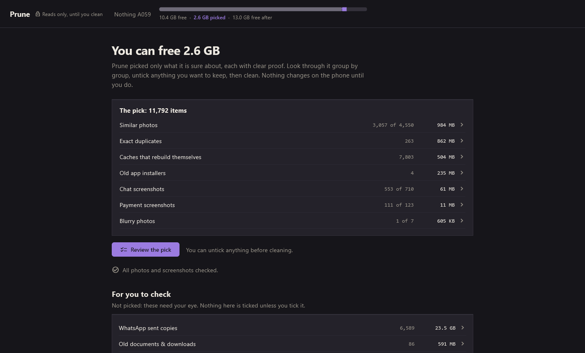
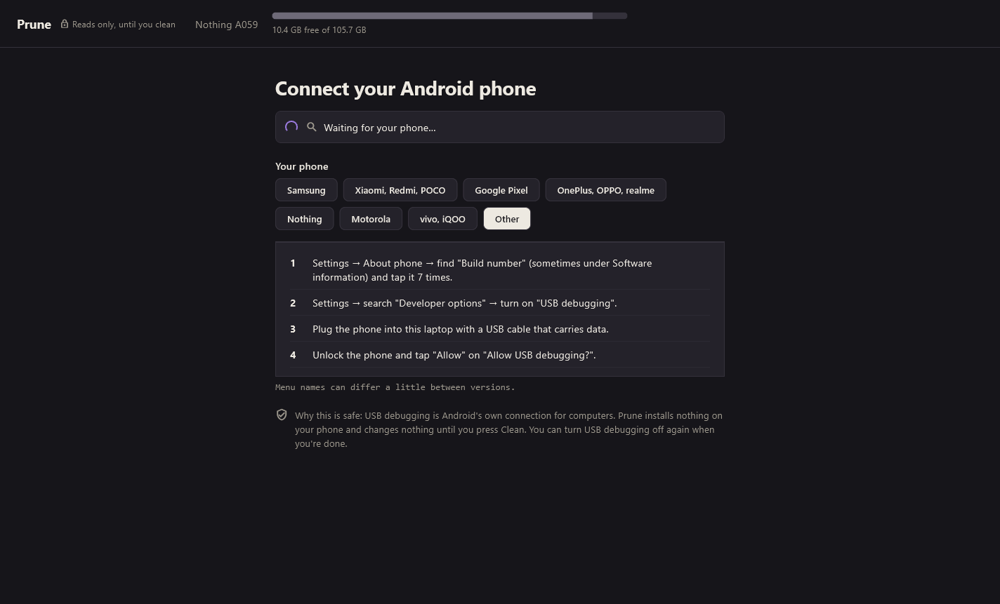

<div align="center">


# Prune

### Your phone is hiding gigabytes.<br>Prune finds them, and shows proof for every pick.

Plug your Android phone into a Windows laptop. Prune reads it, finds what is safe to remove,<br>
tells you exactly why, and removes only what you confirm. Nothing ever leaves your laptop.


<br>



</div>

<br>

## What one phone was hiding

These are real numbers from the phone Prune was built on: a Nothing Phone with 106 GB of storage and 10 GB free.

<table>
<tr>
<td align="center" width="33%"><h2>33.5 GB</h2>in <b>44,280 files</b> that Android leaves out of its own file list</td>
<td align="center" width="33%"><h2>23.5 GB</h2>of <b>WhatsApp sent copies</b>: a second copy of every photo and video you've sent</td>
<td align="center" width="33%"><h2>11,792</h2><b>sure picks</b> in one sitting, each with its proof</td>
</tr>
</table>

WhatsApp quietly keeps a copy of everything you send. Gallery apps don't show them, and most people never find out. Prune does, and shows you each one before anything happens.

## Proof, not "trust me"

Most cleaners show a bucket called "junk" and ask you to tap Delete. Prune shows its working:

- **Every pick has its picture** (or a PDF page, an app icon, a playable video) and its file name.
- **"How we know"** lists the facts behind each pick: the matching copy, the size and date, the text it read.
- **Duplicates sit side by side** with the copy that stays, and the sharpest of similar photos is kept.
- **Only what Prune is sure about is ticked.** Everything else waits, unticked, for your eye.

## It understands your screenshots

| Group | How Prune knows |
|---|---|
| **Chat screenshots** | Recognises WhatsApp, Instagram, Telegram, Messenger, Discord, LinkedIn, Snapchat, text messages and AI chats, and groups them **by person** |
| **Payment screenshots** | A success message plus proof: an amount, a UPI ID or a reference number |
| **Other screenshots** | Grouped by the app or website on screen |
| **Exact duplicates** | The same contents, checked on the phone; the copy in the most original place stays |
| **Similar photos** | Look-alikes taken close together; the sharpest stays |
| **Blurry photos** | Sharpness and detail measures; photos with people are never ticked |
| **And more** | WhatsApp sent copies, old installers, old documents, voice notes, large videos, accidental clips, caches |

## How it works

<table>
<tr>
<td width="33%" valign="top"><h3>1 · Connect</h3>Turn on USB debugging and plug in. Prune's setup screen has the exact steps for Samsung, Xiaomi, Pixel, OnePlus, Nothing, Motorola and vivo, and tells you if your cable only charges.</td>
<td width="33%" valign="top"><h3>2 · Review</h3>Prune reads the phone and checks every photo on your laptop: about 16,000 photos in under 20 minutes. Look through the pick group by group and untick anything you want to keep.</td>
<td width="33%" valign="top"><h3>3 · Clean</h3>Picks go to your phone's Trash for 30 days. Hidden files are backed up to your laptop first. Changed your mind? Undo.</td>
</tr>
</table>

<div align="center">

</div>

## Safe by design

- **Nothing changes until you press Clean.** Reading, checking and reviewing only ever read.
- **Your phone's Trash keeps everything for 30 days**, and Prune backs up hidden files to `Prune Backups` on your laptop first.
- **Before removing anything**, Prune checks that the file is still the one it listed.
- **Every clean-up is recorded**, so Undo works even after a pulled cable.
- **Prune installs nothing on your phone.**

## Private by design

- **No account, no upload, no analytics, no internet use.** Your photos, chats and payments stay on your laptop.
- Photos are copied to the laptop in batches to be checked, then deleted straight away.
- Text read from screenshots is encrypted with your Windows account.
- **Forget this phone** wipes everything Prune saved about it.

## Get Prune

Download `Prune-1.0.0-Setup.exe` (installs for you only, no admin rights) or the portable `Prune-1.0.0.zip` from **Releases**, then follow the [user guide](docs/USER_GUIDE.md).

Needs Windows 10 or 11 (64-bit), an Android phone and a USB cable that carries data. Windows may show "Windows protected your PC" the first time, because Prune isn't signed with a paid certificate yet: click **More info**, then **Run anyway**.

<details>
<summary><b>Build from source</b></summary>

<br>

Needs Flutter (stable) with the Windows desktop toolchain (Visual Studio "Desktop development with C++"), the Android SDK platform-tools (for `adb`), and optionally Inno Setup 6 for the installer.

```powershell
.\packages\vision_helper\build.ps1      # the text-reading helper (uses Windows' own C# compiler)
cd apps\declutter
flutter run -d windows                  # run in development
cd ..\..
.\tool\package.ps1                      # dist\Prune-<version>.zip and -Setup.exe
```

Tests:

```powershell
cd packages\engine; dart test
cd ..\store; dart test
cd ..\phone_link; dart test
cd ..\vision_helper; dart test
cd ..\..\apps\declutter; flutter test -x phone
```

Tests tagged `phone` only read from a connected phone. Tests that clean run only on a confirmed Android emulator and are skipped unless you ask for them (`dart test -P emulator`).

| Folder | What it is |
|---|---|
| `apps/declutter` | The Windows app (Flutter) |
| `packages/engine` | The rules: what counts as junk, and why (pure Dart) |
| `packages/phone_link` | Talking to the phone over adb, read-only except the cleaner |
| `packages/store` | The local database |
| `packages/vision_helper` | `PruneVision.exe`: text reading, faces and previews, using Windows' built-in engines |
| `tool` | Packaging, installer and icon scripts |
| `docs` | The user guide and screenshots |
| `design` | Logo and design notes |

</details>

## Limits

Android only: iPhones can't be read this way. Photos in Google Photos' cloud aren't checked, only what is on the phone. HEIC photos need Microsoft's HEIF/HEVC extensions.

<br>

<div align="center">
<sub>Built for people whose galleries run to tens of thousands of images. Prune: cut carefully, keep what grows.</sub>
</div>
